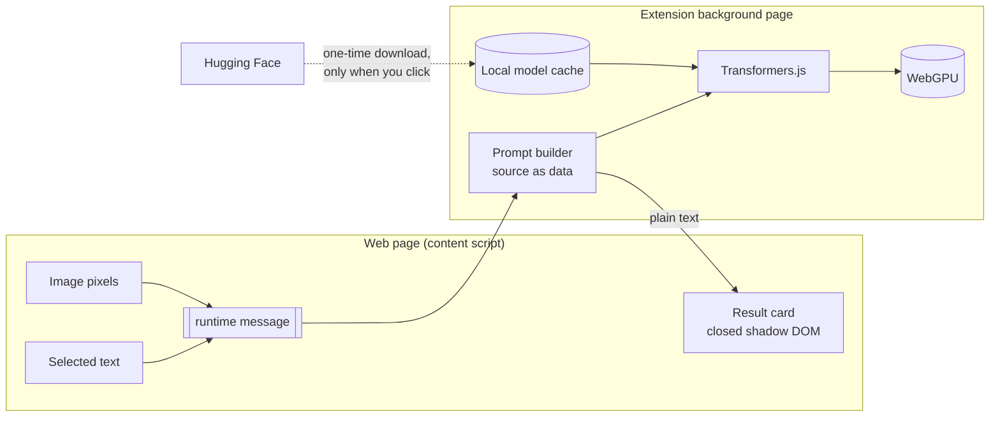

<div align="center">


# AegisTranslate

**Private, on-device translation for Firefox, including the text inside images.**

Manga, comics, infographics, forum posts and papers, translated by Qwen models
running locally on your own GPU. Nothing you read leaves your computer.

[](https://github.com/Nexoniarz/AegisTranslate/actions/workflows/ci.yml)
[](LICENSE)


[](https://github.com/Nexoniarz/Niveus)

</div>

<p align="center">
  <picture>
    <source media="(prefers-color-scheme: dark)" srcset="assets/screenshots/overlay-dark.png">
    
  </picture>
</p>
<p align="center"><sub>UI preview with sample output. Interface built with <a href="https://github.com/Nexoniarz/Niveus">Niveus</a>.</sub></p>

---

## Why

Cloud translators see everything you read. Built-in browser translation stays local but
can't read text inside images, which is where manga, memes, scans and infographics keep it.

AegisTranslate puts a small vision-language model in your browser and runs it through
WebGPU. Text and images are processed on your machine, and the extension never contacts a
translation server.

## Features

| | |
|---|---|
| 🔒 **Local only** | Inference runs on your GPU. The only network requests are model downloads you start yourself. |
| 🖼️ **Image text** | Hover an image and click **Translate** to read speech bubbles, captions and signs. |
| 📝 **Selected text** | Right-click → *Translate selection*, or press <kbd>Alt</kbd>+<kbd>Shift</kbd>+<kbd>T</kbd>. |
| 🎛️ **Your choice of models** | Pick a text model (1.7B or 4B) and, if you want image translation, a separate vision model. |
| 🔌 **Off when you want** | One switch turns it off and frees VRAM immediately. |
| 🛡️ **Injection-aware** | Page content is treated strictly as data, and the model has no tools or network to misuse. |

<p align="center">
  <picture>
    <source media="(prefers-color-scheme: dark)" srcset="assets/screenshots/popup-dark.png">
    
  </picture>
</p>

## Models

| Purpose | Model | Download | Notes |
|---|---|---|---|
| Text | Qwen3 1.7B | ~1.3 GB | Fast, fine for most languages |
| Text | Qwen3 4B | ~2.8 GB | Best quality, needs a stronger GPU |
| Images | Qwen2-VL 2B | ~1.6 GB | Reads and translates image text |
| Images | Qwen3-VL 2B | ~1.8 GB | Newer vision model |

All models are 4-bit quantized ONNX builds from Hugging Face, loaded with
[Transformers.js](https://github.com/huggingface/transformers.js). They are downloaded once,
stored in the browser's cache, and can be deleted from the popup.

## Install

> AegisTranslate is in early alpha and isn't on addons.mozilla.org yet.

**Requirements:** Firefox 142 or newer with WebGPU working (`about:support` → search for
*WebGPU*), and roughly 2–4 GB of free VRAM, depending on the models you choose.

```bash
git clone https://github.com/Nexoniarz/AegisTranslate.git
cd AegisTranslate
npm install
npm start
```

`npm start` builds the extension and opens a Firefox profile with it loaded. To load it into
your own profile instead, run `npm run build`, open `about:debugging` → *This Firefox* →
*Load Temporary Add-on…*, and choose `dist/manifest.json`.

## How it works



1. The content script reads the selected text, or the image pixels already in the page.
2. The background page wraps that content in delimiters as data and runs the chosen model on
   your GPU.
3. The translation comes back as plain text and is shown in a card inside a closed shadow
   root. Page scripts can't restyle it, and nothing is ever inserted as HTML.

### Interface

The popup and the in-page cards are built with [Niveus](https://github.com/Nexoniarz/Niveus),
vendored under `vendor/niveus/`. The popup uses it unchanged. For the overlay, the build
generates a copy scoped to the shadow root (`:root` → `:host`, `rem` pinned to 16px, no
`@font-face`), so the card looks the same on every site and adds nothing to the page that
scripts could detect.

## Privacy

- No analytics, no telemetry, no accounts.
- No translation server: inference runs entirely on your device.
- Model downloads go to `huggingface.co` and happen only when you press **Download**.
- If a page's image can't be read directly (cross-origin), the extension re-reads it from the
  same URL. This is normally served from the browser's cache.

See [PRIVACY.md](PRIVACY.md) for the full policy.

### What about Tor Browser?

Tor Browser disables WebGPU and advises against installing extensions, since each one makes
you easier to fingerprint. AegisTranslate is therefore aimed at regular and hardened Firefox.
It is not recommended for Tor Browser.

## Development

```bash
npm run build     # bundle into dist/
npm test          # unit tests
npm run lint      # build, then run web-ext lint
npm start         # build, then launch Firefox with the extension
npm run package   # build an .xpi/.zip in web-ext-artifacts/
```

```
src/
  background.js   model loading, prompts, inference
  content.js      hover button and result cards
  popup.js        settings UI
  models.js       model catalog and defaults
  vendor/         build-time patches that let ONNX Runtime run without eval
static/           manifest, HTML, CSS, icons
vendor/niveus/    Niveus design system (CSS + fonts)
assets/           logo and screenshots
```

## Roadmap

- [x] Selected-text translation
- [x] Image translation with a vision model
- [x] Model download, load, unload and delete from the popup
- [ ] Translations drawn directly over each speech bubble
- [ ] Translate the whole page
- [ ] Verify downloaded model files against pinned checksums
- [ ] Import model files from disk (no network at all)
- [ ] Publish on addons.mozilla.org

## Contributing

Bug reports, model suggestions and pull requests are welcome. See
[CONTRIBUTING.md](CONTRIBUTING.md). To report a security issue, see [SECURITY.md](SECURITY.md).

## License

[Apache License 2.0](LICENSE) © 2026 Nexoniarz.

Model weights are not included in this repository. Each model has its own license; see its
model card on Hugging Face. Third-party code is listed in
[THIRD_PARTY_NOTICES.md](THIRD_PARTY_NOTICES.md).
