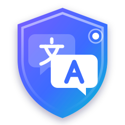
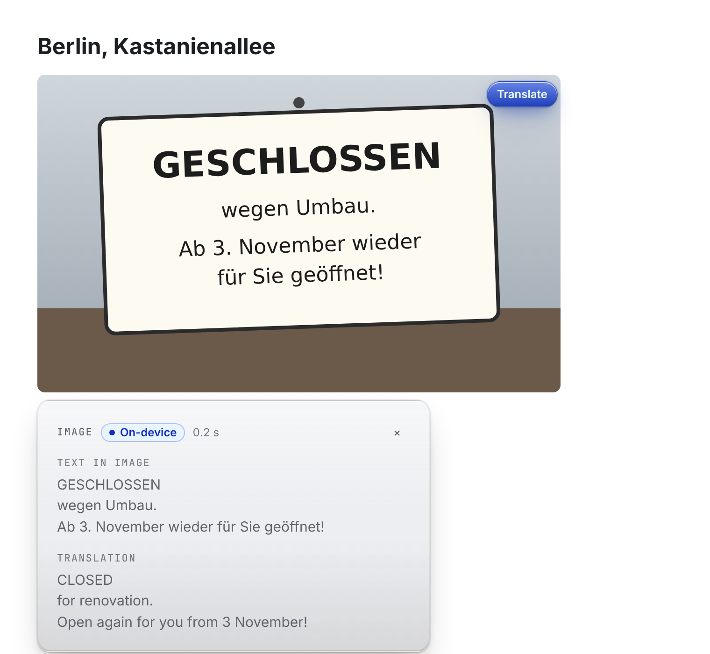
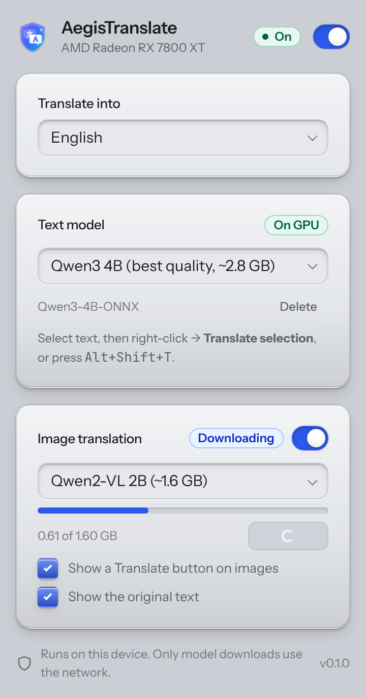
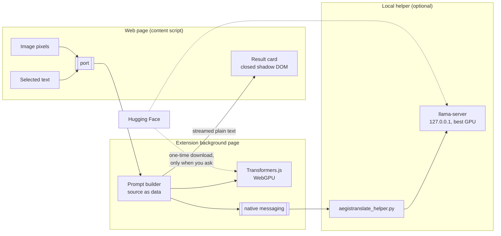

<div align="center">



# AegisTranslate

**Private, on-device translation for Firefox, including the text inside images.**

Select text or click any image (screenshots, signs, scans, comics, charts) and read
it in your language. Qwen models run on your own GPU, inside Firefox or through a small
local helper. Nothing you read leaves your computer.

[](https://github.com/Nexoniarz/AegisTranslate/actions/workflows/ci.yml)
[](LICENSE)


[](https://github.com/Nexoniarz/Niveus)

</div>

<p align="center">
  <picture>
    <source media="(prefers-color-scheme: dark)" srcset="assets/screenshots/overlay-dark.png">
    
  </picture>
</p>
<p align="center"><sub>UI preview with sample output. Interface built with <a href="https://github.com/Nexoniarz/Niveus">Niveus</a>.</sub></p>

---

## Why

Cloud translators see everything you read. Built-in browser translation stays local but
can't read text inside images, which is where screenshots, scans, memes, comics and
infographics keep it.

AegisTranslate runs Qwen language and vision models on your machine. Text and images are
processed locally, and the extension never contacts a translation server.

## Features

| | |
|---|---|
| 🔒 **Local only** | Inference runs on your hardware. The only network requests are model downloads you start yourself. |
| 🖼️ **Text in any image** | Hover an image and click **Translate**. You get the text found in the image and its translation. |
| 📝 **Selected text** | Right-click → *Translate selection*, or press <kbd>Alt</kbd>+<kbd>Shift</kbd>+<kbd>T</kbd>. |
| 📄 **Whole page** | Right-click → *Translate page*, the popup button, or <kbd>Alt</kbd>+<kbd>Shift</kbd>+<kbd>P</kbd>. Translated in place, what's on screen first, with *Show original* one click away. |
| ⚡ **Two engines** | *In browser* needs no install. *Local helper* runs llama.cpp on your most powerful GPU, for example the dedicated card in a hybrid laptop or desktop. |
| 🌊 **Streaming** | Translations appear word by word, with a timer. Closing the card stops the work. If a model gets stuck repeating itself, it is stopped and the repetition is cut. |
| 🔌 **Off when you want** | One switch turns it off and frees VRAM immediately. |
| 🛡️ **Injection-aware** | Page content is treated strictly as data, and the model has no tools or network to misuse. |

<p align="center">
  <picture>
    <source media="(prefers-color-scheme: dark)" srcset="assets/screenshots/popup-dark.png">
    
  </picture>
</p>

## Engines and models

Choose the engine in the popup. Images are handled in two steps: the vision model reads the
text in the image, then the text model translates it.

### In browser (WebGPU)

Runs inside Firefox with [Transformers.js](https://github.com/huggingface/transformers.js) on
the GPU Firefox uses. Nothing to install.

| Purpose | Model | Download |
|---|---|---|
| Text | Qwen3 1.7B | ~1.3 GB |
| Text | Qwen3 4B | ~2.8 GB |
| Images | Qwen2-VL 2B | ~1.6 GB |
| Images | Qwen3-VL 2B | ~1.8 GB |

Models are 4-bit ONNX builds from Hugging Face, stored in Firefox's cache and deletable from the
popup.

### Local helper (llama.cpp)

A small Python script, [`helper/aegistranslate_helper.py`](helper/aegistranslate_helper.py), runs
[llama.cpp](https://github.com/ggml-org/llama.cpp) on your dedicated GPU. It is usually
much faster than WebGPU and can run larger models. On hybrid-GPU machines it uses the dedicated
card without changing how Firefox itself runs.

| Purpose | Model | Download |
|---|---|---|
| Text | Qwen3 4B | ~2.5 GB |
| Text | Qwen3 8B | ~5 GB |
| Images | Qwen2.5-VL 3B | ~3 GB |
| Images | Qwen3-VL 4B | ~3.3 GB |
| Images | Qwen2.5-VL 7B | ~6 GB |

If two models don't fit in VRAM together, the helper unloads one to load the other.

## Install

> AegisTranslate is in early alpha and isn't on addons.mozilla.org yet.

**Requirements:** Firefox 142 or newer. For the *In browser* engine, WebGPU must work
(`about:support` → search for *WebGPU*). Allow roughly 2–6 GB of free VRAM, depending on the
models you choose.

```bash
git clone https://github.com/Nexoniarz/AegisTranslate.git
cd AegisTranslate
npm install
npm start
```

`npm start` builds the extension and opens a Firefox profile with it loaded. To load it into
your own profile instead, run `npm run build`, open `about:debugging` → *This Firefox* →
*Load Temporary Add-on…*, and choose `dist/manifest.json`.

## Local helper

You install it once. After that Firefox starts it on your first translation and stops it after
a few idle minutes (set in the popup), when you switch translation off, or when Firefox closes.
It never runs in the background on its own.

It needs Python 3 and `llama-server` from llama.cpp, built for your GPU (CUDA for NVIDIA,
Vulkan for any vendor, Metal on macOS).

### Linux and macOS

```bash
./helper/install.sh
```

The script installs the helper for your user, registers it with Firefox, and prints the GPU it
will use. If `llama-server` isn't on your `PATH`, pass it:
`LLAMA_SERVER=/path/to/llama-server ./helper/install.sh`. Remove it with
`./helper/install.sh --uninstall`.

### NixOS

Add the helper to Firefox's native messaging hosts in `configuration.nix`:

```nix
programs.firefox.nativeMessagingHosts.packages = [
  (pkgs.callPackage /path/to/AegisTranslate/helper { })
];
```

Without arguments you get the Vulkan build, which works with any GPU vendor (NVIDIA included)
and comes prebuilt from the NixOS binary cache. `cudaSupport = true` builds llama.cpp with CUDA
instead; it needs `nixpkgs.config.allowUnfree = true` and compiles locally the first time.
On PRIME offload setups neither needs `nvidia-offload`: the helper uses the NVIDIA card for
compute while Firefox stays on the integrated GPU.

**[Full NixOS guide](docs/NIXOS.md)**: flakes, Home Manager, installing without a clone, CUDA,
hybrid graphics (PRIME offload) and troubleshooting.

### Then

Open the popup, choose **Engine → Local helper**, allow the permission Firefox asks for, and
press **Check**. The header shows the GPU the helper picked.

### Choosing a different GPU

The helper prefers a dedicated GPU over an integrated one (integrated GPUs report shared system
RAM, so they often look bigger), then the one with the most memory. To force one, put its
llama.cpp device name
(shown by `aegistranslate-helper --check`) in `~/.config/aegistranslate/helper.json`:

```json
{ "device": "CUDA0" }
```

The same file accepts `"context"` (context size in tokens, default 4096) and `"extra_args"` (a list
passed to `llama-server`). Downloaded models are stored in the Hugging Face cache,
`~/.cache/huggingface/hub` (older llama.cpp versions use `~/.cache/llama.cpp`).

## How it works



1. The content script reads the selected text, or the pixels of the image you clicked.
2. The background page wraps that content in delimiters as data and sends it to the chosen
   engine. For an image, the vision model first transcribes the text, then the text model
   translates it.
3. Tokens stream back as plain text into a card inside a closed shadow root. Page scripts can't
   restyle it, and nothing is ever inserted as HTML. Closing the card cancels generation.

The local helper talks to Firefox only through native messaging (stdin/stdout). It runs
`llama-server` on `127.0.0.1` with a random port, and stops it when Firefox disconnects. On
Linux, `llama-server` is also stopped if the helper itself is killed.

### Interface

The popup and the in-page cards are built with [Niveus](https://github.com/Nexoniarz/Niveus),
vendored under `vendor/niveus/`. The popup uses it unchanged. For the overlay, the build
generates a copy scoped to the shadow root (`:root` → `:host`, `rem` pinned to 16px, no
`@font-face`), so the card looks the same on every site and adds nothing to the page that
scripts could detect.

## Privacy

- No analytics, no telemetry, no accounts.
- No translation server: inference runs entirely on your device.
- Model downloads go to `huggingface.co` and happen only when you press **Download** or
  **Load**, or the first time the local helper loads a model.
- If a page's image can't be read directly (cross-origin), the extension re-reads it from the
  same URL. This is normally served from the browser's cache.

See [PRIVACY.md](PRIVACY.md) for the full policy.

### What about Tor Browser?

Tor Browser disables WebGPU and advises against installing extensions, since each one makes
you easier to fingerprint. AegisTranslate is therefore aimed at regular and hardened Firefox.
It is not recommended for Tor Browser.

## Development

```bash
npm run build     # bundle into dist/
npm test          # unit tests (JavaScript and the Python helper)
npm run test:e2e  # extension + real helper + fake llama-server in Chromium (needs Playwright)
npm run lint      # build, then run web-ext lint
npm start         # build, then launch Firefox with the extension
npm run package   # build an .xpi/.zip in web-ext-artifacts/
```

```
src/
  background.js      routes jobs to the chosen engine, streams results
  browser-engine.js  Transformers.js on WebGPU
  helper-client.js   native-messaging client for the local helper
  prompts.js         translation and image-reading prompts
  content.js         Translate button and result cards
  popup.js           settings UI
  models.js          model catalogs and defaults
  vendor/            build-time patches that let ONNX Runtime run without eval
helper/              local helper: script, installer, Nix package
docs/                NixOS guide, addons.mozilla.org listing
static/           manifest, HTML, CSS, icons
vendor/niveus/    Niveus design system (CSS + fonts)
assets/           logo and screenshots
```

## Roadmap

- [x] Selected-text translation
- [x] Image translation with a vision model
- [x] Model download, load, unload and delete from the popup
- [x] Local helper engine (llama.cpp on the best GPU)
- [x] Streaming results and cancel on close
- [x] Translate the whole page
- [ ] Verify downloaded model files against pinned checksums
- [ ] Import model files from disk (no network at all)
- [ ] Publish on addons.mozilla.org

## Contributing

Bug reports, model suggestions and pull requests are welcome. See
[CONTRIBUTING.md](CONTRIBUTING.md). To report a security issue, see [SECURITY.md](SECURITY.md).

## License

[Apache License 2.0](LICENSE) © 2026 Nexoniarz.

Model weights are not included in this repository. Each model has its own license; see its
model card on Hugging Face. Third-party code is listed in
[THIRD_PARTY_NOTICES.md](THIRD_PARTY_NOTICES.md).
